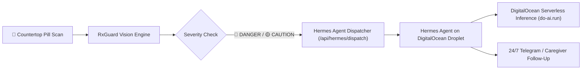

# RxGuard — Visual Medication Safety & Conflict Copilot
### Powered by Google Gemma & DigitalOcean AI Tools + 1-Click Hermes Autonomous Agent

[](https://cloud.digitalocean.com/apps/new?repo=https://github.com/clencyc/gemma-demo)

An AI-powered visual medication safety and polypharmacy copilot that protects patients, caregivers, and seniors from dangerous drug-drug interactions, duplicate active ingredients (overdoses), food/drink contraindications, and incorrect dosing timing.

RxGuard seamlessly combines **Google's Gemma Multimodal models (Gemini API)**, **DigitalOcean Serverless Inference (`https://inference.do-ai.run/v1`)**, and **Nous Research's 24/7 Hermes Agent** running on a **DigitalOcean Droplet**.

---

## 🌊 DigitalOcean AI Tools & 1-Click Hermes Deployment (Judging Criteria)

This project directly incorporates DigitalOcean's AI ecosystem:

### 1. ⚡ DigitalOcean Serverless Inference Integration (`app/do_ai.py`)
- Direct integration with DigitalOcean's managed inference endpoint: `https://inference.do-ai.run/v1`.
- Provides managed cloud inference on open models (e.g. Llama 3.3 70B, DeepSeek).
- Easily configured via `DO_MODEL_ACCESS_KEY` in `.env`.
- Accessible via the in-app AI engine selector toggle or directly via `/api/do/ask`.

### 2. 🚀 1-Click Deploy Hermes Agent on DigitalOcean
- **Marketplace 1-Click Droplet:** Deploy a pre-configured Ubuntu 24.04 Droplet with persistent storage and systemd services in one click:
  👉 [**Launch Hermes 1-Click Droplet on DigitalOcean**](https://cloud.digitalocean.com/droplets/new?image=hermes-agent)
- **Automated Cloud-Init Script:** Run [`scripts/deploy_hermes_droplet.sh`](file:///C:/Users/levono/desktop/gemma-demo/scripts/deploy_hermes_droplet.sh) on any fresh DigitalOcean Droplet:
  ```bash
  curl -sSL https://raw.githubusercontent.com/clencyc/gemma-demo/main/scripts/deploy_hermes_droplet.sh | bash
  ```
- **App Platform Spec:** Deploy RxGuard directly via DigitalOcean App Platform using [`.do/app.yaml`](file:///C:/Users/levono/desktop/gemma-demo/.do/app.yaml).

### 3. 🤖 24/7 Hermes Autonomous Caregiver Workflow

When RxGuard flags a high-risk medication conflict (e.g. fatal duplicate acetaminophen overdose), the clinical payload is automatically dispatched to the **Hermes 24/7 Caregiver Agent on DigitalOcean**, which tracks adherence, answers patient questions, and alerts emergency contacts.

---

## 🚨 The Clinical Problem: The Silent Crisis of Polypharmacy

- **40% of older adults** take 5 or more medications daily.
- **Accidental Acetaminophen Toxicity** (taking NyQuil + Tylenol + a prescription painkiller like Percocet simultaneously) is the **#1 cause of acute liver failure** in the United States.
- Tiny pill bottle print, obscure chemical names, and subtle food contraindications (e.g., grapefruit blocking statin metabolism, or calcium binding to thyroid medication) lead to preventable hospitalizations every year.

---

## 🏆 Standout Features

- **📸 Multi-Bottle Countertop Scan:** Photograph multiple pill bottles, blister packs, or prescription sheets together on your kitchen counter.
- **⚡ Conflict Radar & Polypharmacy Shield:** Automatically cross-references all active ingredients for:
  - **Duplicate Active Ingredients:** Flags hidden overlaps (e.g. 🔴 *Lethal duplicate acetaminophen detected*).
  - **Severe Drug Interactions:** Warns of incompatible drug mechanisms.
  - **Food & Beverage Traps:** Identifies dietary conflicts (e.g. Grapefruit + Lipitor/Atorvastatin, Dairy + Antibiotics).
  - **Critical Spacing Rules:** Enforces time separation (e.g. Synthroid 4 hours away from Iron/Calcium).
- **🗓️ 24-Hour Interactive Pillbox Grid:** Generates a structured Morning, Afternoon, Evening, and Bedtime schedule with dosage cards.
- **📅 1-Click Apple/Google Calendar Export (.ics):** Generates and downloads a recurring `.ics` calendar reminder schedule complete with daily alarms.
- **🚨 Paramedic / Doctor Emergency Wallet Card:** Formats an instant, printable emergency card for first responders (EMTs) and emergency room doctors.
- **👵 "Grandma Mode" (Voice Audio & High Contrast):** Integrated Web Speech API audio explanation in warm, plain English (under 80 words, zero medical jargon) with a high-contrast senior mode.
- **⚡ 1-Click Judge Demo Scenarios:** Built-in test presets (Fatal Overdose Trap, Food & Spacing Trap, Safe Regimen) for rapid 10-second hackathon judging evaluation.
- **🛡️ Model Fallback & Exponential Backoff:** Retries transient API errors and automatically falls back between configured Gemma models (`gemma-4-26b-a4b-it` and `gemma-4-31b-it`).

---

## 🛠️ Technology Stack

| Layer | Technology |
|---|---|
| **Backend** | Python 3.10+, FastAPI, Uvicorn |
| **Multimodal Vision** | Google Gemma models via Gemini API (`google-genai` SDK) |
| **Cloud AI Inference** | DigitalOcean Serverless Inference (`https://inference.do-ai.run/v1`) |
| **Autonomous Agent** | Nous Research Hermes Agent deployed on DigitalOcean Droplet |
| **Cloud Deployment** | DigitalOcean App Platform (`.do/app.yaml`) & 1-Click Marketplace Droplet |
| **Frontend** | Responsive Glassmorphism CSS3, Web Speech API, Vanilla JS |
| **Testing** | `pytest`, FastAPI `TestClient`, `httpx` (30 automated tests) |

---

## 🚀 Quick Start

### 1. Clone & Set Up

```bash
git clone https://github.com/clencyc/gemma-demo.git
cd gemma-demo
```

### 2. Configure Environment (`.env`)

```dotenv
# Google Gemini API key (for Gemma multimodal vision)
GEMINI_API_KEY=your_gemini_api_key_here

# DigitalOcean AI Tools (optional, for DO Serverless Inference)
DO_MODEL_ACCESS_KEY=your_do_model_access_key
DO_INFERENCE_ENDPOINT=https://inference.do-ai.run/v1
DO_INFERENCE_MODEL=llama-3.3-70b-instruct

# Hermes Agent Webhook (optional, for live Droplet dispatch)
HERMES_AGENT_WEBHOOK_URL=http://your-droplet-ip:8000/webhook
```

### 3. Run Locally

```powershell
python -m uvicorn app.main:app --reload
```
Open **http://127.0.0.1:8000** in your browser.

---

## 🧪 Automated Tests

Run the complete test suite (30 passing tests):
```powershell
python -m pytest
```

---

## 🎯 Hackathon Pitch & Judge Demo Script (2 Minutes)

1. **The Hook (15s):** Show the kitchen counter problem—hold up or show a photo with 3 pill bottles (Percocet, Tylenol, NyQuil). Explain how easily a patient could accidentally overdose on acetaminophen.
2. **The 1-Click Evaluation (30s):** Click the **"🔴 Lethal Overdose Conflict"** preset in RxGuard. Watch Gemma or DigitalOcean Serverless Inference instantly flag the severe duplicate acetaminophen toxicity with a **DANGER** alert badge.
3. **Grandma Mode (20s):** Click the **"🔊 Read Aloud"** button. The browser reads the plain-English explanation without medical jargon. Toggle **"👵 Senior Mode"** to show high-contrast large fonts.
4. **Hermes & DigitalOcean Deployment (30s):**
   - Click **"🌊 1-Click Deploy Hermes"** in the top bar to show the 1-Click DigitalOcean Droplet launch button and automated script.
   - Click **"🤖 Dispatch Alert to Hermes 24/7 Agent"** to show the live dispatch of the alert to the autonomous caregiver on DigitalOcean.
5. **The Action Kit (15s):** Click **"📅 Export to Calendar"** to show the generated `.ics` schedule with alarms, and **"🚨 Emergency Card"** for EMTs.
6. **The Closer (10s):** Emphasize how combining Gemma's multimodal vision with DigitalOcean AI and Hermes creates a true 24/7 life-saving healthcare system.
